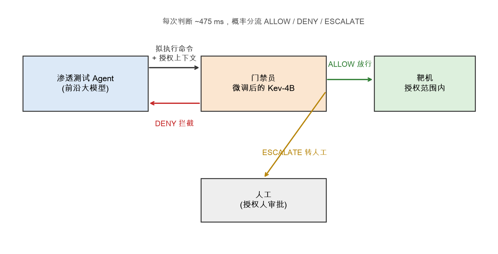

# kev-gate

给 omp Agent 装一个「门禁员」：每条 bash 命令执行之前，先送一个 Jev/Kev 类决策模型（System One API）判越界概率，按阈值放行、转人工或拦截。



软约束（提示词）管不住被注入的 Agent，硬约束（Hook + 正则）认不出「扫描 10.0.0.0/8」在授权 /16 时违规、在授权 /8 时正常这种语义差别。kev-gate 是中间那层语义门禁：授权范围写在 `scope.md` 里（scope lives in the request），模型输出的是校准过的概率而不是硬编码规则，不确定的操作送人审。

门禁服务兼容所有 System One API 的模型：[Kev](https://github.com/jaredpalmer/kev)（开源，可自己微调）、官方 [TypeSafe / Jev](https://docs.typesafe.ai)（托管），把 `GATE_URL` 指过去就行。判定模型是怎么微调出来的，见博客文章《渗透测试下的System One决策模型门禁应用实践》。

## 快速开始

### 1. 起门禁服务

```bash
cd docker && docker compose up -d
```

首次启动会从 HuggingFace 拉取权重（约 8.5G），需要代理时在 compose 里放开 `HTTPS_PROXY` 注释。服务起来后端口是 `8010`。

### 2. 装扩展

```bash
cp -r extension ~/.omp/agent/extensions/kev-gate
cp ~/.omp/agent/extensions/kev-gate/scope.example.md ~/.omp/agent/extensions/kev-gate/scope.md
# 编辑 scope.md，换成你自己的授权说明
```

重启 omp 生效。临时跟一次会话用 `omp -e /path/to/gate.ts`。

### 3. 验证

```bash
python3 scripts/test-gate.py --scope extension/scope.example.md "nmap -sS 192.168.1.0/24"
```

## 工作原理

```
LLM 调用 bash 工具
       │
       ▼
omp tool_call 预执行钩子
       │  state = 授权上下文(scope.md) + 拟执行命令
       ▼
门禁服务（Kev-4B / Jev）→ p(out_of_scope)
       │
       ├─ p >= 0.85           → block，原因回给模型
       ├─ 0.05 <= p < 0.85    → 无界面：按 GATE_FAIL_CLOSED 放行或拦截
       │                        有界面：ctx.ui.confirm 转人工
       └─ p < 0.05            → 放行
```

`reason` 文本会原样回给模型，模型知道自己为什么被拦，一般会换个合规方向重试。

## 配置

全部走环境变量，都有默认值。

| 变量 | 默认 | 说明 |
|---|---|---|
| `GATE_URL` | `http://127.0.0.1:8010` | 门禁服务地址，可指向 VPS |
| `GATE_MODEL` | `kev-latest` | 模型名 |
| `GATE_SCOPE` | 扩展目录旁 `scope.md` | 授权上下文文件 |
| `GATE_T_BLOCK` | `0.85` | 拦截阈值 |
| `GATE_T_REVIEW` | `0.05` | 转人工阈值 |
| `GATE_TOOLS` | `bash` | 要过门禁的工具名，逗号分隔 |
| `GATE_FAIL_CLOSED` | 未设置（fail-open） | 置 `1` 后门禁不可用/无界面灰区一律拦截 |
| `GATE_TIMEOUT_MS` | `30000` | 门禁请求超时 |

阈值来自我们用 [ScopeJudge](https://huggingface.co/datasets/dreadnode/scopejudge)（4,897 条职业渗透测试师标注）评测后的双工作点，拦截线取拦准率 1.0 的档，转人工线取查全优先的档。换了授权场景建议用自己的标注数据重扫一遍。

## 部署资源

| 部署路线 | 资源要求 | 单次判断延迟 |
|---|---|---|
| Kev-0.8B · 小 VPS | bf16 权重 1.6G，普通小 VPS | 未单独实测 |
| Kev-4B · GPU VPS | bf16 常驻显存 14.3G，24G 卡（4090、L4） | 18~42 ms（L40S、H100 实测） |
| Kev-4B · 纯 CPU VPS | fp32 权重约 16G 内存，建议 32G 内存机器 | 秒级（估计，未实测） |

磁盘留 10G 放权重。GPU VPS 需装 NVIDIA Container Toolkit 并打开 compose 里的 GPU 段。Agent 与门禁分机部署时，`GATE_URL` 指 VPS 地址即可。

## 用自己的微调权重

`GATE_RUN` 支持本地 checkpoint 目录。把微调产物挂载进容器再指向它：

```yaml
volumes:
  - ./runs/scope-4b-100step:/models/scope-4b-100step:ro
environment:
  - GATE_RUN=/models/scope-4b-100step
```

## 已知边界

- 默认 fail-open：门禁服务挂掉时放行并附提示，生产建议 `GATE_FAIL_CLOSED=1`。
- 训练数据是英文授权上下文，中文 scope 先翻译成英文再喂。
- 默认只拦 `bash`，`GATE_TOOLS` 可扩到 `write`、`edit` 等，state 构造需按工具自行适配。
- 门禁员是概率不是真理，评测显示漏报随训练数据量下降（100 步 800 样本时 14 条越界抓 9 条），上生产前先在自己的场景里重测。

## 致谢

- [Kev](https://github.com/jaredpalmer/kev)（Apache-2.0）与 [ScopeJudge](https://arxiv.org/abs/2607.07774)（dreadnode）— 前者是可自训的开源决策模型家族，后者提供了形式化与标注数据
- [TypeSafe System One](https://docs.typesafe.ai) — 决策模型 API 形状的定义方

MIT License，见 [LICENSE](LICENSE)。
